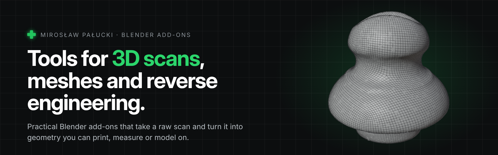
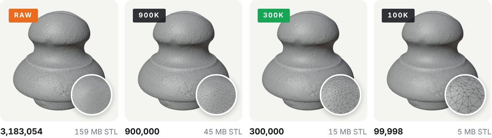
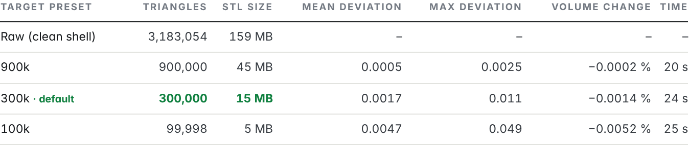
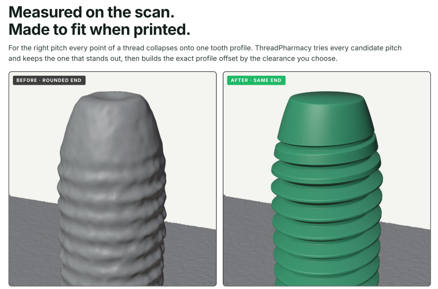
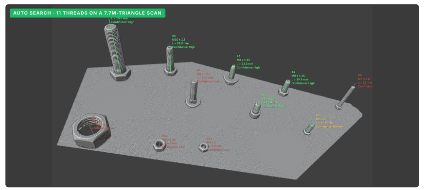
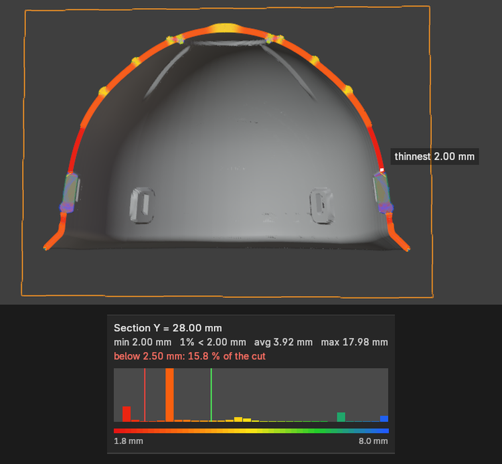

<p align="center">
  
</p>

# Blender add-ons for 3D scans, meshes and reverse engineering

This repository is the public home of my Blender add-ons. It holds the product pages, user guides and release notes.
The add-ons are distributed through [Superhive (formerly Blender Market)](https://superhivemarket.com). The source code ships with every purchase under the GPL, as Blender add-ons require.

All the tools target the same job: you have a raw scan, and you need geometry you can **3D print, measure, boolean or model on**, without leaving Blender.

---

## Add-ons

| Add-on | What it does | Status |
|---|---|---|
| **[MeshPharmacy](meshpharmacy/)** | Cleans, repairs, reduces and quad-remeshes dense scan meshes. Removes hidden interior shells, fills holes, reports whether the result is watertight. Always works on a copy. | v1.4 |
| **[ThreadPharmacy](threadpharmacy/)** | Finds threads on a scan automatically (or from your clicks), measures axis, size and pitch, and rebuilds them as clean ISO, inch, hydraulic or pipe threads. Print-fit option for 3D printing. Always works on a copy. | v1.0.3 |
| **[MeshUnderskin](meshunderskin/)** | Look under the skin of a mesh: a live section with a wall-thickness heatmap and histogram, finds thin walls, and can add material on a copy. A visual guide, not a simulation. [Get it on Gumroad](https://mpcoreanalytics.gumroad.com/l/MeshUnderskin). | v1.6.3 |

<p align="center">
  <a href="meshpharmacy/"></a>
  <br><sub>MeshPharmacy · section view of a scan: hidden interior shells (orange) removed.</sub>
</p>

<p align="center">
  <a href="meshpharmacy/"></a>
  <br><sub>Same spot on a scanned part: raw scan (3.19M triangles) → Resize to target (300k) → Quads (14.5k).</sub>
</p>

<p align="center">
  <a href="meshpharmacy/"></a>
  <a href="meshpharmacy/"></a>
  <br><sub>Fewer triangles, same part: 159 MB → 15 MB at 300k, volume change about 0.001 %.</sub>
</p>

<p align="center">
  <a href="threadpharmacy/"></a>
  <br><sub>ThreadPharmacy · the scanned thread end (left) rebuilt as a clean thread (right), measured on the scan.</sub>
</p>

<p align="center">
  <a href="threadpharmacy/"></a>
  <br><sub>ThreadPharmacy · automatic search: 11 threads found on a 7.7M-triangle scan, each with a confidence level.</sub>
</p>

<p align="center">
  <a href="meshunderskin/"></a>
  <br><sub>MeshUnderskin · a section of the part colored by wall thickness, with a histogram: thin walls show up in red.</sub>
</p>

More tools for the same pipeline (alignment, measurement, scan-to-CAD helpers) will be added here as they are released.

---

## How the family fits together

```
 3D scanner  ──►  STL / OBJ  ──►  MeshPharmacy  ──►  ThreadPharmacy  ──►  3D print / CAD / Boolean
                                  clean · repair      rebuild threads
                                  reduce · remesh     on a clean mesh
```

[MeshUnderskin](meshunderskin/) sits next to this chain: run it on a repaired mesh to see where the walls are too thin before you print.

Each add-on does one job well and leaves your original object untouched. They follow the same rules:

- **Non-destructive.** Every operation creates a new, clearly named object. The source is hidden, never edited.
- **Measured, not guessed.** Every run ends with a short report: face counts, deviation from the source, watertight check.
- **Responsive on big scans.** Heavy work runs in a background Blender process, so the viewport stays usable on multi-million-triangle meshes.
- **No extra installs.** Only what ships with Blender. No pip packages, no external binaries.
- **Current Blender.** Built and tested for Blender 4.2 LTS and newer.

---

## About me

**Mirosław Pałucki** · [LinkedIn](https://www.linkedin.com/in/mirosław-pałucki-7948ba35)

Digitalization specialist with 17+ years of international experience in aerospace, automotive and battery manufacturing, working where engineering, quality and IT meet. My foundation is industrial metrology, quality management and precision inspection: SPC, MSA, ISO 9001, ISO 17025 and NADCAP on one side, SQL, Python, Power BI and Tableau on the other.

Next to that I work on reverse engineering, 3D scanning (structured light, laser, NIR) and physical-to-digital workflows. I build tools and add-ons for Blender and Autodesk Fusion that close the gap between raw scan data and production-ready CAD geometry: mesh processing, surface reconstruction and automated data preparation.

These add-ons started as tools I needed myself: raw scans that were too heavy, full of hidden junk, or had threads too blurred to use. I build them the way I expect an engineering tool to behave. Predictable, reversible, and honest about what it changed.

---

## Support

- **Questions and bug reports:** use the message function on the product's Superhive page, or open an [issue](../../issues) in this repository.
- **Documentation:** each add-on folder has a README and a PDF guide.

## License

Documentation, images and text in this repository: [CC BY-NC-ND 4.0](LICENSE).
The add-ons are licensed **GPL-3.0-or-later** and distributed through Superhive.

© 2026 Mirosław Pałucki
