

  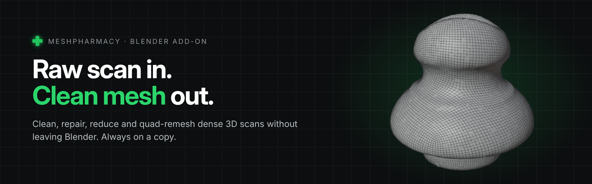

# MeshPharmacy

**Clean, repair, reduce and quad-remesh dense 3D scan meshes directly in Blender.**

Raw scans are heavy and messy: millions of triangles, duplicate vertices, floating debris, shells hidden inside the part, open holes, broken topology. MeshPharmacy fixes all of that from one sidebar panel and tells you, in numbers, what it changed.

**[Download the product guide (PDF, 6 pages)](docs/MeshPharmacy_Product_Guide.pdf)**

| | |
|---|---|
| **Version** | 1.3.0 |
| **Blender** | 4.2 LTS and newer |
| **Dependencies** | None. Uses only modules bundled with Blender |
| **License** | GPL-3.0-or-later |
| **Store** | Superhive (link will be added at launch) |

---

## How it works

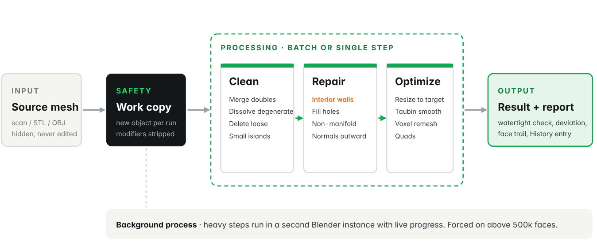

Select a mesh, tick the steps you need and press **Run all selected**. MeshPharmacy duplicates the object, hides the original and runs every step on the duplicate.

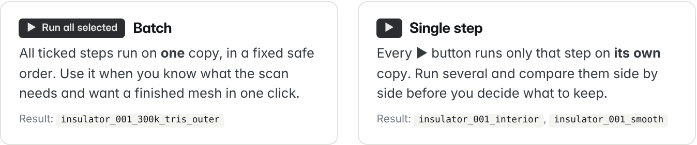

- **Run all selected (batch):** all ticked steps run on one copy, in a fixed order, so steps never undo each other.
- **▶ Single step:** each button runs one step on its own copy. Run several, compare them side by side, keep the one you like.

The source object is never edited. Ctrl+Z works as usual, and **Restore visibility** brings back exactly the objects a run hid.

---

## Remove interior walls

Scanners record surfaces through openings and from overlapping passes. Those end up as loose shells **inside** the part: invisible in the viewport, but they cause phantom walls in the slicer and failed Booleans.

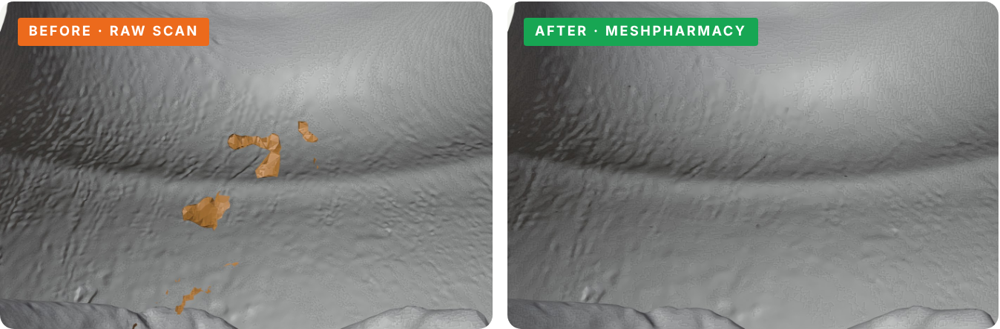

*Section view through the neck of a scanned insulator. The orange pieces are separate shells floating inside the body. In this scan: 78 shells, 75 of them inside (7,347 faces). After the run: one clean outer shell.*

MeshPharmacy ray-casts every shell against the main body on three axes and removes the ones that sit inside, whatever their size. If a step would remove too much (more than 30% of the faces for interior walls, 10% for small islands), it is skipped and the report says why.

---

## Repair and verify

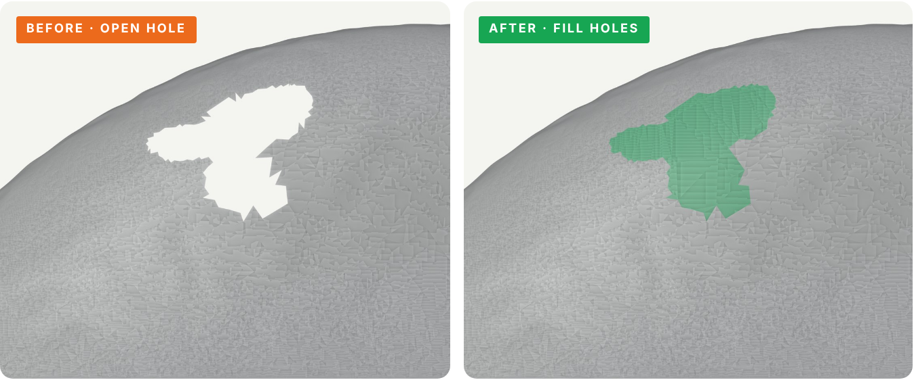

- **Fill holes** up to a chosen size: 0.5%, 2%, 5% of the object size, or all.
- **Non-manifold repair:** removes faces on edges shared by three or more faces and around bow-tie vertices, with a 3% safety limit.
- **Normals outward:** every face points out, as slicers expect.

Every run ends with a report in the **History** panel:

  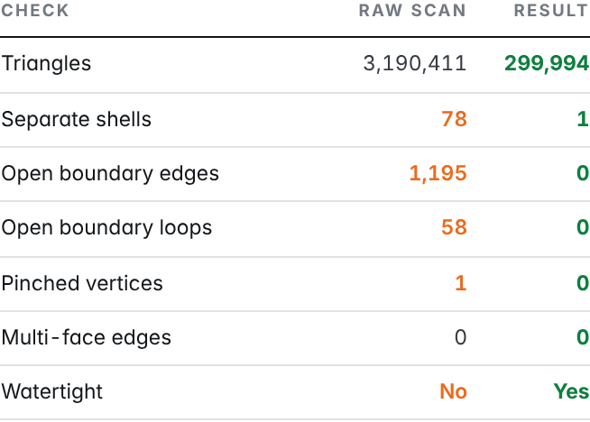
  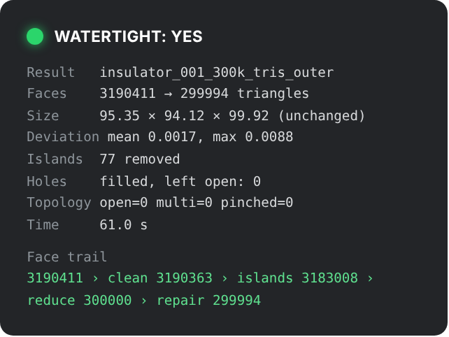

*Real numbers from one batch run on a 3.19M-triangle scan: 61 s on a 2-core test machine, watertight result, face trail showing which step removed what.*

---

## Reduce without losing the part

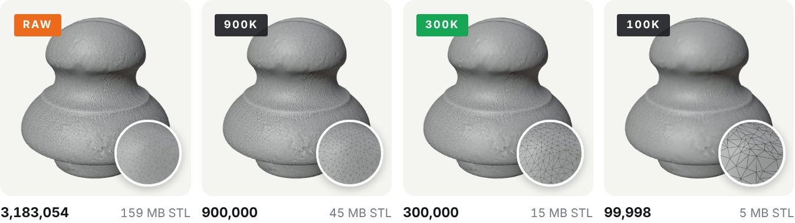

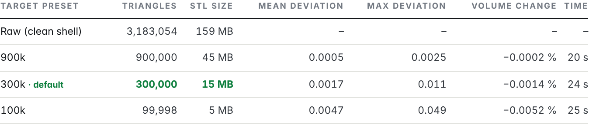

**Resize to target** decimates to a preset (100k, 300k, 600k, 900k, 2M) or a custom count, and subdivides when the mesh is below the target. A 159 MB STL becomes 15 MB at 300k, and the volume changes by about one thousandth of a percent.

---

## Smooth in three strengths

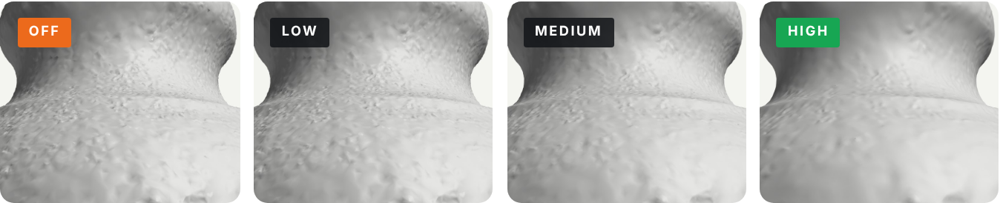

Taubin smoothing (Low, Medium, High) removes scanner noise **without shrinking the part**: every shrink step is followed by an inflate step. If smoothing ever changes the volume by more than 2%, the report warns you.

*Fine noise was added to this example on purpose, to make the difference visible.*

---

## Quads, when you need them

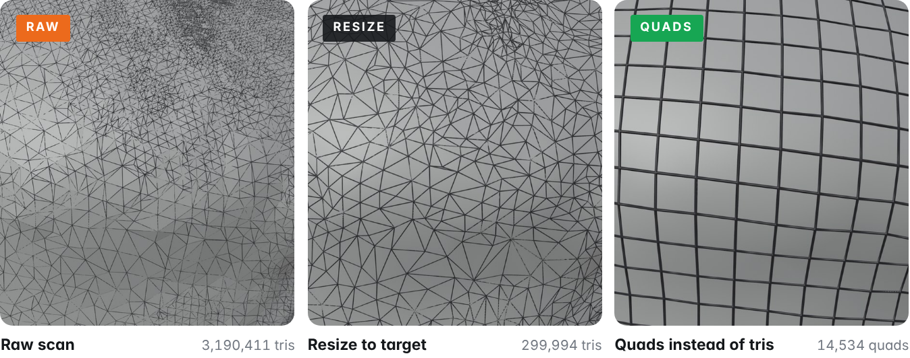

**Quads instead of tris** uses Blender's built-in QuadriFlow to rebuild the surface as an even quad grid near your target count, for sculpting, retopology or CAD-style work. **Voxel remesh** is there too, for a uniform rebuild of badly broken scans.

---

## Full feature list

- **Clean:** merge doubles · dissolve degenerate · delete loose · remove small islands
- **Repair:** remove interior walls · fill holes (size limit) · non-manifold repair · normals outward
- **Optimize:** resize to target (presets or custom) · Taubin smooth (3 levels) · voxel remesh · quads (QuadriFlow)
- **Workflow:** batch or single-step · always on a copy · background processing (forced above 500k faces) · History panel with report · Restore visibility · Undo

## Requirements and limits

- Blender 4.2 or newer. No extra Python packages.
- Very dense scans need RAM and time; both Blender processes share your machine. Start with Resize to target only.
- Target counts are approximate: cleanup, repair and QuadriFlow all change the final number slightly.
- Voxel remesh and decimation do not preserve UV maps and vertex colors reliably.

## Install

1. Edit › Preferences › Add-ons (or *Get Extensions*) › **Install from Disk**.
2. Select `mesh_pharmacy.zip`.
3. In the 3D Viewport press **N** and open the **MeshPharmacy** tab.

## Version history

- **1.3.0** · Collapsible option groups, cleaner History panel, Restore visibility now restores exactly what a run hid.
- **1.2.0** · Safer visibility handling, distance-based limit for the interior-wall test.
- **1.1.0** · Per-step ▶ buttons, Run all selected, smooth strength, History panel, background processing.
- **1.0.0** · First release.

---

Part of the [Mirosław Pałucki Blender add-ons](../) family · Documentation © 2026 Mirosław Pałucki, [CC BY-NC-ND 4.0](../LICENSE)
