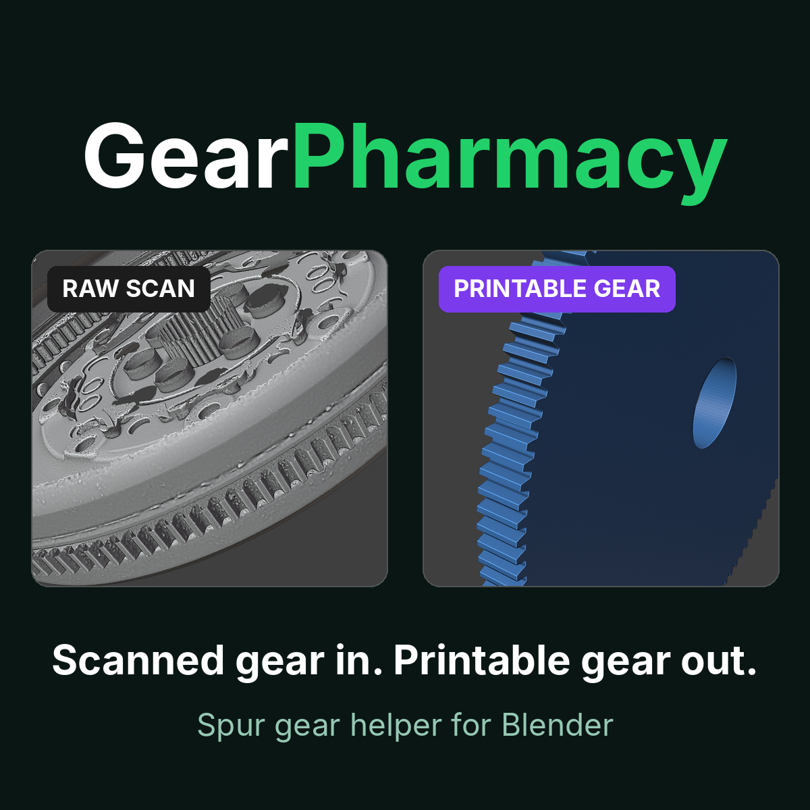
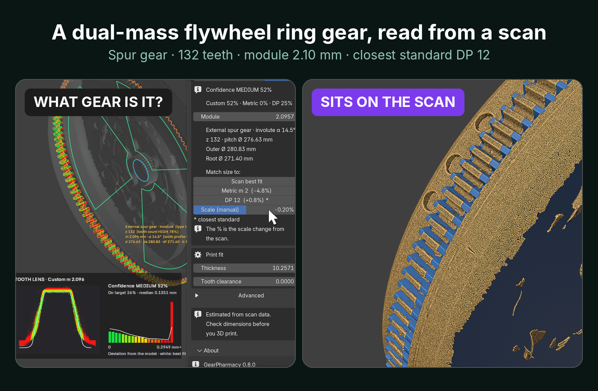

# GearPharmacy

**Scanned gear in. Printable gear out.** Click a spur gear in your 3D scan, let GearPharmacy tell you what gear it is, and rebuild it as a clean, watertight mesh you can 3D print.

  

> **A helper for hobbyists and makers, not a measuring tool.** GearPharmacy gives an **estimate** from your scan, not a measurement, and **no guaranteed accuracy**. The result depends on scan quality. Always check the dimensions on the real part before you 3D print it or order a replacement.

Scanned gears are noisy, worn and full of holes, and counting 132 teeth by hand is nobody's idea of fun. GearPharmacy fits an ideal spur gear to the teeth you mark, in 3D, and tells you what it found: tooth count, size, the closest standard size and how sure it is. Then it builds a clean copy with even teeth, a bore and a hub of your choice. A visible arc of a few complete teeth is enough.

**[Download the user guide (PDF, 7 pages)](docs/GearPharmacy_User_Guide.pdf)** · **[Get GearPharmacy on Gumroad](https://mpcoreanalytics.gumroad.com)**

| | |
|---|---|
| **Version** | 0.8.0 |
| **Blender** | 4.2 and newer (developed and tested on Windows with Blender 5.3) |
| **Dependencies** | None. Uses only modules bundled with Blender |
| **License** | GPL-3.0-or-later |
| **Get it** | [Gumroad](https://mpcoreanalytics.gumroad.com) |
| **Family** | Works well after [MeshPharmacy](../meshpharmacy/): repair the scan first, then read the gear |

---

## How it works

**1 · Mark one gear.** Click once on the teeth and the visible toothed rim is marked for you, or paint the teeth with a small brush. A meshing neighbour gear and the flat faces are left out.

**2 · Detect.** An ideal spur gear is fitted to the marked scan points in 3D: axis and tilt, centre, size, rotation and face width. Involute and straight-sided teeth are both tried.

**3 · Read the result.** External spur gear, number of teeth, module or diametral pitch, pressure angle, outer and root diameter, each with a HIGH, MEDIUM or LOW confidence. A green-to-red heatmap and a tooth lens with a histogram show how well the scan sits on the model.

**4 · Pick the size.** Keep the scan's best fit, or snap to the closest Metric module or DP with one click. Fine-tune with a manual scale and watch the heatmap turn green.

**5 · Build a clean copy.** Set thickness, bore (round, keyway, single or double flat, or solid), hub and spokes, with a live preview on the scan. **Create Clean Copy** builds a new watertight mesh, named after what it is. The scan is never changed.

  
   A dual-mass flywheel scan (4.4M triangles): 140° of teeth painted, 132 teeth found, closest standard DP 12. Right: the scan points sit on the rebuilt gear.

---

## What to expect

- **Non-destructive.** The scan stays untouched. Every clean copy is a new object.
- **Honest about itself.** Three confidences (type, tooth count, tooth profile) tell you how well the scan supports each number. A short arc gives a lower tooth-count confidence: mark more teeth or type the known count.
- **Metric and inch.** Module or diametral pitch, millimetres or inches.
- **Scope.** External spur gears with involute or straight-sided teeth. Helical teeth are reported but rebuilt as spur. Bevel, worm and internal (ring) gears are not supported.
- **Needs real scan data.** Dense vertices on at least three complete teeth. Low-polygon CAD meshes are not suitable.
- **Mesh output only.** Use the clean copy as a visual reference or export it for 3D printing.

---

Part of the [Mirosław Pałucki Blender add-ons](../) family · Documentation © 2026 Mirosław Pałucki, [CC BY-NC-ND 4.0](../LICENSE)
