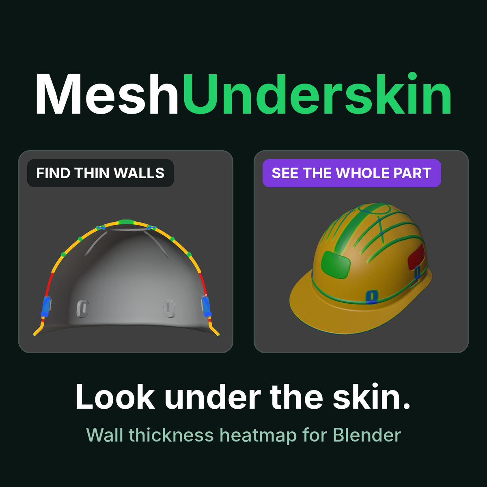
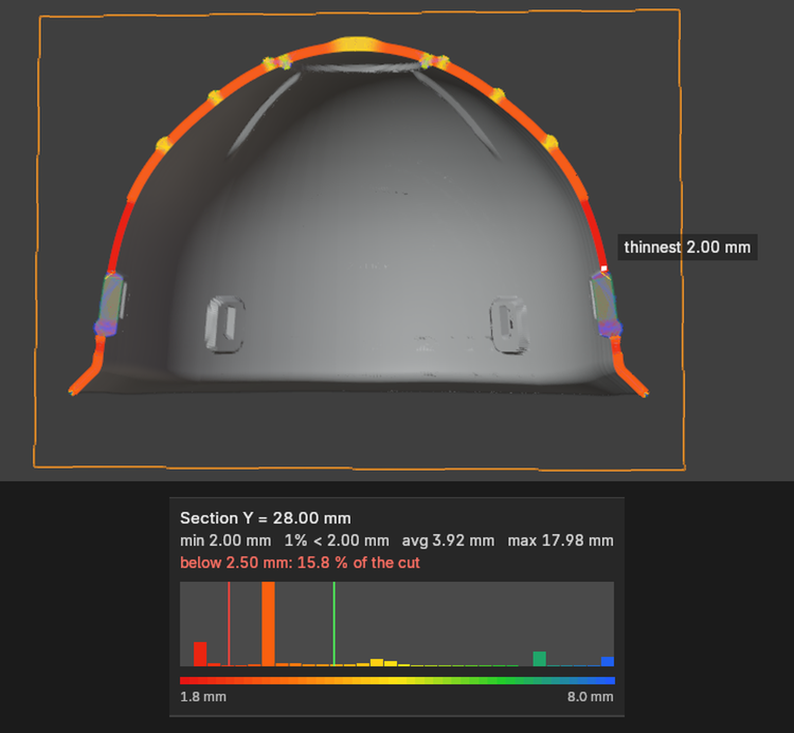

# MeshUnderskin

**Look under the skin. Find the thin wall.** A live section view with a wall-thickness heatmap for Blender, so you can see where a part is too thin before you print, cast or mold it.

  

> **Visual guide only.** MeshUnderskin is **not a metrology tool** and gives **no certified or guaranteed results**. It contains **no simulation and no strength, fatigue or FEA calculations**. Colors and numbers only indicate wall thickness measured on the mesh. Always check the real part with proper measuring equipment and testing. Results are reliable only on a **closed, repaired mesh**.

Thin walls are easy to miss on a scan or a model: the outside looks fine, and the problem sits in the middle of the wall. MeshUnderskin cuts the part with a plane you can move and tilt, colors the cut by wall thickness, and shows a histogram of the result. Then it measures the whole object, selects the thin faces and, if you want, adds material on a copy.

| | |
|---|---|
| **Version** | 1.6.3 |
| **Blender** | 4.2 LTS and newer (developed and tested on Windows with Blender 5.2) |
| **Dependencies** | None. Uses only modules bundled with Blender |
| **License** | GPL-3.0-or-later |
| **Family** | Works well after [MeshPharmacy](../meshpharmacy/): repair the scan first, then measure it |

---

## Three tools in one panel

**1 · Cross Section.** Slide and tilt a plane through the part and see the wall thickness of the cut in color, live while you move it. Set your own Min and OK thickness, or a color range in millimetres. The thinnest spot is marked in the viewport, and a histogram (vertical bars, a table, or a graph along the cut edge) shows how much of the cut is thin.

  

**2 · Analysis.** Measures every face of the object, colors the whole part, selects the thin faces for you, and shows volume and weight in the material you pick.

**3 · Reinforce (extra).** Where the wall is too thin, adds material on a copy of the part: a plain thickening, lines, a grid or a honeycomb of ribs. Auto settings fit the values to the size of your object. The added material shows on the section in its own color, and the original is never changed.

---

## What to expect

- **Non-destructive.** The cut is a modifier that Uncut removes. Reinforcement is always built on a copy.
- **Plain numbers.** Section stats show thinnest, 1 % under, average and maximum thickness. "1 % under" is the thickness that only 1 % of the cut is thinner than, a more realistic minimum than a single noisy spot on a scan.
- **Heavy scans.** Tested on a 2.9 M-triangle scan: section updates in about 50 ms.
- **Needs a closed mesh.** Open or non-manifold meshes can still be measured, but the cut face may not close. Repair the scan first, for example with MeshPharmacy.

---

Part of the [Mirosław Pałucki Blender add-ons](../) family · Documentation © 2026 Mirosław Pałucki, [CC BY-NC-ND 4.0](../LICENSE)
