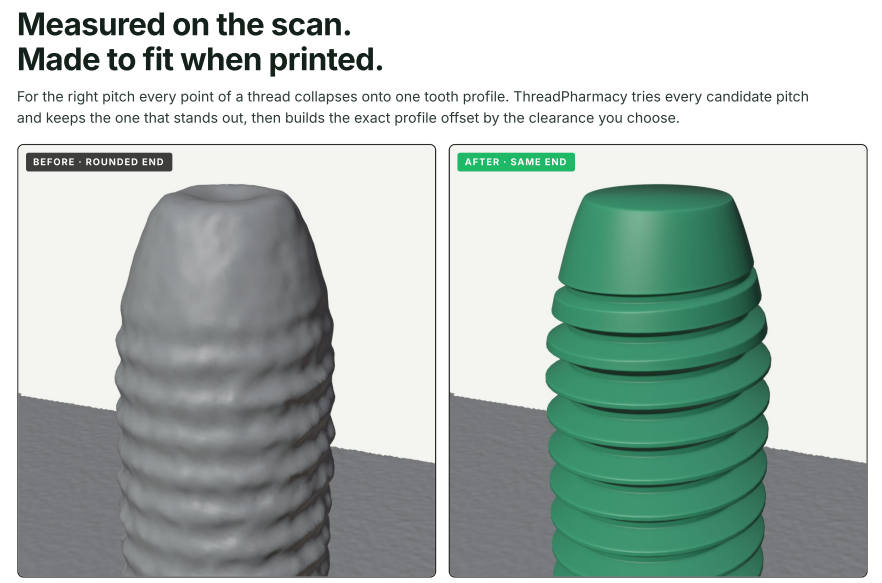
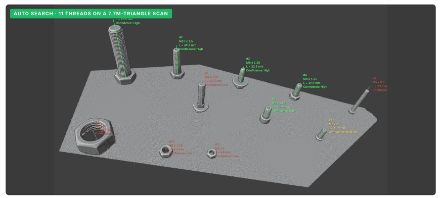
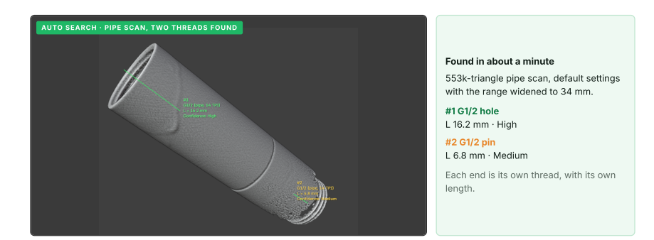

# ThreadPharmacy

**Rx for broken threads.** Rebuild clean threads on 3D-scanned parts, directly in Blender: ISO metric, inch (UNC/UNF), SAE hydraulic and pipe threads.

Threads are the weakest spot in almost every scan. Crests come out rounded, the profile drowns in noise, small holes are only half visible, and the axis is a degree or two off. Print it like that and the bolt won't go in.

ThreadPharmacy finds the thread on the scan, measures its axis, diameter and pitch, and replaces it with a mathematically correct one, on the right axis, in a copy of the scan. Your original is never edited.

**[Download the product guide (PDF, 7 pages)](docs/ThreadPharmacy_Product_Guide.pdf)**

| | |
|---|---|
| **Version** | 1.0.2 |
| **Blender** | 4.2 LTS and newer (developed and tested on Windows with Blender 5.1; Linux and macOS are not tested) |
| **Dependencies** | None. Uses only modules bundled with Blender |
| **License** | GPL-3.0-or-later |
| **Family** | Sibling of [MeshPharmacy](../meshpharmacy/). Clean the scan first, then rebuild the threads |

---

## Let it search the whole scan

**Find Threads** searches the scan automatically, with hard limits so a complex scan never keeps you waiting: a size range, pins / holes / both, a maximum number of threads, a maximum length and a time limit. Results come as a list with a confidence level (High, Medium, Low); you tick what you want and press **Apply Checked**. Every thread can be changed to another type, and its length edited, before you build.

It works on poor scans too. Below, a 553k-triangle pipe scan: both ends are found, each with its own thread type and length.

## Or mark the threads yourself

1. **Pick Thread**: click each thread. A ring follows the cursor and shows the analysed area.
2. **Paint Area**: paint a damaged or crowded thread surface with a brush.
3. Press **Find Threads** once: everything you marked is analysed together.

A flat **datum face** next to the thread (3 clicks) fixes the axis exactly perpendicular to it; without it ThreadPharmacy looks for the base face itself.

## What it handles

- **Standards:** ISO metric coarse and fine (M1–M64), inch UNC/UNF/UN (#4 to 1-1/2"), SAE hydraulic fitting threads (JIC, ORB, ORFS: the thread only), pipe threads G (BSPP), R/Rc (BSPT) and NPT, 1/16" to 2". You can limit the search to the standards your parts use.
- **Pitch decides.** Look-alike sizes (M10×1.5 vs M10×1.25, M8 vs 5/16"-18, M20 vs G1/2) are told apart by the measured pitch; when the scan cannot tell, you get a short list to choose from.
- **External and internal threads**, left- and right-hand, through and blind holes, chamfered or rounded pin ends, tapered pipe threads.
- **Hex heads and nuts** can be rebuilt as clean ones (optional).
- **Print fit:** *Optimize for print* makes a pin slightly smaller and a hole slightly larger so a printed part fits real hardware (presets for resin, PLA, PETG, ABS, or a custom value).
- **Safe by design:** the result is a closed, checked mesh in a working copy (`<name>_threads`). Heavy Boolean operations run in a separate process, Esc cancels and rolls back, Ctrl+Z works, and a report with measured vs nominal values can be exported.
- **Debris clean-up:** *Clean Small Debris*, *Clean Big Debris* and *Fill Holes* tidy scraps left beside a new thread.

## What to expect from your scan

The smallest thread that can be detected automatically depends on your scanner, not on the add-on: the thread depth must stand out from the scan noise. On fine or smoothed threads ThreadPharmacy still finds the axis and diameter, and you choose the pitch from the list. Internal threads are harder than external ones because the scanner often only sees the entry. Large internal taper threads (NPT / Rc 3/4" and up) are the hardest case, so check the size. The ISO tables hold nominal values; check sizes that are critical for your application against the standard.

## Tested

On synthetic scans of pins and holes (M6–M16, inch, hydraulic and pipe threads, 0.03 mm noise, missing patches) the size and pitch were read correctly in every test case. On real scans, a blue-laser scan with 8 bolts and 3 nuts (6.1M triangles) had all 11 identified, and Find Threads found all 10 threads in its range without false hits in about 50 s. Details and known limits are in the PDF guide.

---

Part of the [Mirosław Pałucki Blender add-ons](../) family · Documentation © 2026 Mirosław Pałucki, [CC BY-NC-ND 4.0](../LICENSE)
